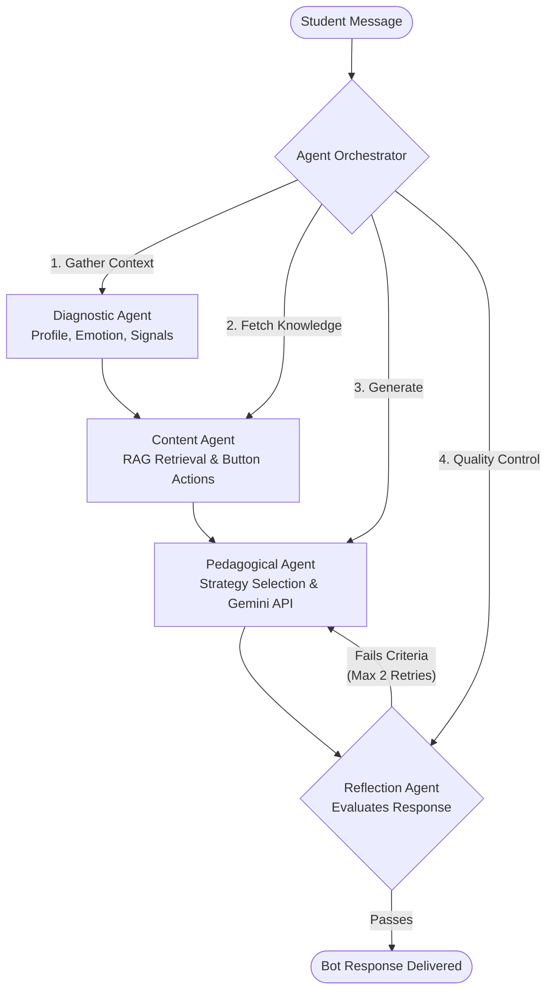

# 🤖 EduBot — Intelligent Pedagogical Chatbot for Moodle

**An AI-powered, multi-agent tutoring assistant embedded directly into Moodle course pages.**

*EduBot utilizes Google Gemini and a robust Retrieval-Augmented Generation (RAG) pipeline to deliver pedagogically sound, emotionally intelligent tutoring without ever giving direct answers.*

---

## 📑 Table of Contents

1. [Overview](#-overview)
2. [Multi-Agent Architecture](#-multi-agent-architecture)
3. [File Structure](#-file-structure)
4. [Data Dictionary](#-data-dictionary)
5. [Core Components & Agents](#-core-components--agents)
6. [AJAX Endpoints](#-ajax-endpoints)
7. [Installation & Settings](#-installation--settings)
8. [Connect with Me](#-connect-with-me)

---

## 🎯 Overview

EduBot (`local_edubot`) injects a floating, context-aware chat widget into every Moodle course. Rather than acting as a simple Q&A bot, it follows strict educational best practices. When a student sends a message, an automated pipeline:
1. **Profiles** the student (knowledge gaps, learning style, emotional state).
2. **Retrieves** relevant course material via vector embeddings (RAG).
3. **Selects** a strategy (e.g., Socratic Questioning, Scaffolded Hints).
4. **Generates** and **Reflects** upon the response to ensure high pedagogical quality.

---

## 🏗️ Multi-Agent Architecture

EduBot operates on a sophisticated multi-agent pipeline triggered by every user interaction.

---

## 📁 File Structure

The project follows standard Moodle plugin conventions, optimized for OOP and background processing.

| Path | Type | Description |
|---|---|---|
| `ajax/` | **Directory** | Handlers for chat messaging, history, UI actions, and AJAX RAG polling. |
| `classes/agents/` | **Directory** | Contains all the distinct LLM agents (Orchestrator, Diagnostic, Pedagogical, etc.). |
| `classes/gemini_client.php` | **File** | Core wrapper for the Gemini API; builds the 4-layer system prompt. |
| `classes/rag_engine.php` | **File** | Manages text extraction, chunking, embedding, and vector similarity search. |
| `classes/student_profiler.php` | **File** | Analyzes Moodle logs to infer Felder-Silverman learning styles and knowledge gaps. |
| `upload_material.php` | **File** | Teacher UI for PDF uploads; queues asynchronous RAG indexing. |
| `db/` | **Directory** | Moodle XML schema, capabilities, event observers, and plugin hooks. |

---

## 🗄️ Data Dictionary

Custom database tables installed by the plugin (prefix: `mdl_`).

| Table Name | Description | Key Fields |
|---|---|---|
| `local_edubot_conversations` | Active and archived chat sessions per user/course. | `id`, `userid`, `courseid`, `title`, `topic` |
| `local_edubot_messages` | Individual chat messages and metadata. | `id`, `conversationid`, `role`, `content`, `strategy`, `emotion` |
| `local_edubot_profiles` | Persisted Felder-Silverman learning styles. | `id`, `userid`, `courseid`, `visual_verbal`, `active_reflective` |
| `local_edubot_chunks` | Segmented course text for semantic search. | `id`, `courseid`, `content`, `metadata` |
| `local_edubot_embeddings` | Vector representations of chunks. | `id`, `chunkid`, `embedding_vector` (JSON float array) |
| `local_edubot_index_status` | Tracks background RAG indexing progress. | `id`, `courseid`, `total_chunks`, `indexed_count`, `status` |

---

## 🧠 Core Components & Agents

### The RAG Engine (`rag_engine.php`)
Implements an end-to-end Retrieval-Augmented Generation pipeline.
* **Extraction:** Uses LlamaParse / Adobe API for complex PDF extraction.
* **Chunking:** 500-character segments with 100-character overlap.
* **Embedding:** Uses `gemini-embedding-001`.
* **Retrieval:** Cosine similarity match (threshold > 0.5) with a keyword-search fallback.

### System Prompt Architecture (`gemini_client.php`)
Assembles prompts in layers to strictly control output:
1. **Master Identity:** Enforces strict/guided constraint modes.
2. **Student Context:** Injects name, mastery level, and emotional state.
3. **Knowledge Base (RAG):** Injects retrieved, verified course facts.
4. **Strategy Engine:** Dictates the pedagogical approach (e.g., *Error Correction* vs *Emotional Support*).

### The Reflection Agent (`reflection_agent.php`)
Acts as an internal quality gate. It reviews the generated response against absolute rules (e.g., "Did the bot give a direct answer?"). If the check fails, it supplies feedback to the Orchestrator to retry the generation (up to 2 times).

---

## 🔌 AJAX Endpoints

| Endpoint | Method | Purpose |
|---|---|---|
| `send_message.php` | `POST` | Main entry; invokes `agent_orchestrator::handle()`. |
| `get_history.php` | `GET` | Fetches conversation history and state. |
| `generate_quiz.php` | `POST` | dynamically spawns an in-chat formative assessment. |
| `reindex_course.php` | `POST` | Manually triggers the RAG embedding pipeline for updated course files. |

---

## ⚙️ Installation & Settings

1. **Clone/Copy** this repository into your Moodle environment: `moodle/local/edubot/`
2. Run the **Moodle Upgrade** process via GUI or CLI (`php admin/cli/upgrade.php`).
3. Navigate to **Site Administration > Plugins > Local plugins > EduBot**.
4. Configure required APIs:
   * **Gemini API Key**
   * **Gemini Model Name** (Default: `gemini-2.0-flash-lite`)
   * **Adobe PDF API Credentials** (for document parsing)
5. **Enable Cron** for background RAG indexing tasks.

---

## 👨‍💻 Connect with Me

This project was built to demonstrate advanced AI integration, LLM orchestration, and intelligent tutoring systems within traditional LMS frameworks. 

**Let's connect!**
* 💼 **LinkedIn:** [Your Name / LinkedIn Profile](https://linkedin.com/in/your-profile-url)
* 📧 **Email:** your.email@example.com
* 🐙 **GitHub:** [github.com/your-username](https://github.com/your-username)