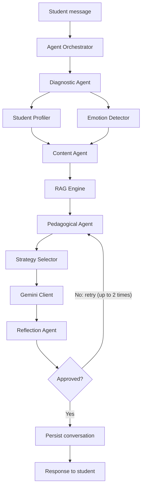
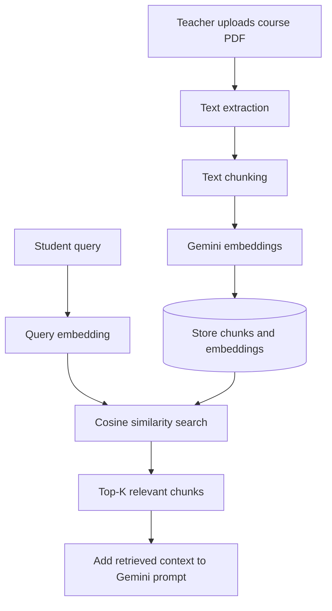

<div align="center">

# EduBot
### An Intelligent, Multi-Agent Pedagogical Tutor for Moodle

<p>
  <strong>Personalized learning support, powered by Google Gemini and Retrieval-Augmented Generation (RAG).</strong>
</p>

<p>
  
  
  
  
  
</p>

<p>
  <a href="#overview">Overview</a> •
  <a href="#features">Features</a> •
  <a href="#architecture">Architecture</a> •
  <a href="#installation">Installation</a> •
  <a href="#configuration">Configuration</a>
</p>

</div>

---

## Table of Contents

- [Overview](#overview)
- [Features](#features)
- [How It Works](#how-it-works)
- [Architecture](#architecture)
- [Technology Stack](#technology-stack)
- [Repository Structure](#repository-structure)
- [Core Components](#core-components)
- [Agent Pipeline](#agent-pipeline)
- [RAG Pipeline](#rag-pipeline)
- [Database Dictionary](#database-dictionary)
- [AJAX Endpoints](#ajax-endpoints)
- [Moodle Hooks and Events](#moodle-hooks-and-events)
- [Configuration](#configuration)
- [Installation](#installation)
- [Background Indexing](#background-indexing)
- [Design Decisions](#design-decisions)
- [Limitations and Notes](#limitations-and-notes)

---

## Overview

**EduBot** is a Moodle local plugin (`local_edubot`) that embeds an AI-powered tutoring assistant into Moodle course pages. It uses the **Google Gemini API** for language generation and semantic embeddings, and follows a multi-agent architecture informed by pedagogical strategies.

When a student sends a message, EduBot builds a learner context, retrieves relevant course material when available, selects a teaching strategy, generates a response, and checks that response before returning it.

The assistant is designed to **guide learning rather than simply provide answers to exercises**. Depending on the configured constraint mode, it can use hints, Socratic questions, explanations, and review-oriented responses.

## Features

- **Moodle course chat widget:** A floating assistant is injected into course pages.
- **Learner profiling:** Combines quiz performance, Moodle activity logs, and conversation signals.
- **Emotion-aware support:** Detects states such as confusion, frustration, anxiety, and excitement from text and behavioral signals.
- **Course-aware RAG:** Extracts and indexes course PDFs, then retrieves relevant text chunks for student questions.
- **Adaptive pedagogical strategies:** Selects from seven strategies based on learner state and interaction context.
- **Response quality review:** A reflection agent evaluates generated responses and can request a retry.
- **In-chat actions:** Supports actions such as hints, explanations, quizzes, examples, and knowledge checks.
- **Post-quiz debrief:** Starts a personalized debrief flow after a Moodle quiz attempt is submitted.
- **Background indexing:** Uses a Moodle scheduled task to process course materials.

## How It Works

1. A student opens a Moodle course and uses the EduBot chat widget.
2. The diagnostic agent builds a learner-state snapshot.
3. The content agent retrieves relevant course material through RAG and interprets any chat-button action.
4. The pedagogical agent selects a strategy and requests a response from Gemini.
5. The reflection agent checks the response against pedagogical and system constraints.
6. The orchestrator stores the interaction and returns the response to the chat widget.

## Architecture



### Main system components

| Component | Responsibility |
|---|---|
| Moodle plugin layer | Adds the chat widget, settings, hooks, events, and AJAX endpoints. |
| Agent orchestrator | Coordinates the chat pipeline and stores messages. |
| Diagnostic agent | Builds the learner-state snapshot. |
| Content agent | Retrieves course context and parses chat actions. |
| RAG engine | Extracts, chunks, embeds, stores, and retrieves course content. |
| Pedagogical agent | Selects a strategy and generates a response through Gemini. |
| Reflection agent | Reviews response quality and requests retries when needed. |
| Database | Stores conversations, messages, learner profiles, RAG chunks, embeddings, and indexing progress. |

## Technology Stack

| Area | Technology / component | Role |
|---|---|---|
| Learning platform | Moodle | Course environment and plugin host |
| Backend | PHP | Plugin logic, agents, endpoints, and Moodle integration |
| Language generation | Google Gemini API | Generates tutoring responses |
| Embeddings | Gemini `gemini-embedding-001` | Creates semantic representations of course text and queries |
| Retrieval | RAG + cosine similarity | Finds course-material passages relevant to a query |
| Database | Moodle database (MySQL in the documented RAG flow) | Persists plugin data |
| Frontend | Moodle AMD JavaScript modules, CSS, HTML | Chat interface and interactions |
| PDF extraction | PDF extraction integration | Extracts text from uploaded course PDFs |

> **Note:** The project documentation identifies LlamaParse in the PDF extraction library comment and Adobe PDF Services credentials in plugin settings. Confirm which extraction provider is active in the current code before describing it as the sole production dependency.

## Repository Structure

The plugin is located at `local/edubot/` inside a Moodle installation.

| Path | Purpose |
|---|---|
| `version.php` | Plugin version and dependencies |
| `lib.php` | Moodle hook functions and chat-widget HTML |
| `settings.php` | Site-administration settings |
| `upload_material.php` | Teacher interface for uploading PDFs and queuing indexing |
| `extract_txt_pdf.php` | PDF text-extraction library |
| `ajax/` | AJAX request handlers |
| `amd/` | Moodle AMD JavaScript modules |
| `assets/` | CSS, images, and static assets |
| `classes/` | Core services, helpers, and Moodle integration classes |
| `classes/agents/` | Agent pipeline and indexing/debrief orchestration |
| `classes/form/` | Moodle form definitions |
| `classes/task/` | Scheduled background tasks |
| `db/` | Install schema, upgrades, capabilities, events, hooks, and cache definitions |
| `lang/en/` | English language strings |

### Important files

| File | Responsibility |
|---|---|
| `classes/gemini_client.php` | Gemini API wrapper and layered system-prompt builder |
| `classes/rag_engine.php` | Course-material indexing and retrieval |
| `classes/student_profiler.php` | Learner profile construction from Moodle data |
| `classes/strategy_selector.php` | Maps learner state to a pedagogical strategy |
| `classes/emotion_detector.php` | Detects affective state from text and behavioral signals |
| `classes/agents/agent_orchestrator.php` | Main chat-pipeline coordinator |
| `classes/agents/diagnostic_agent.php` | Gathers learner state |
| `classes/agents/content_agent.php` | RAG retrieval and chat-action parsing |
| `classes/agents/pedagogical_agent.php` | Strategy selection and Gemini response generation |
| `classes/agents/reflection_agent.php` | Reviews generated responses |
| `classes/agents/debrief_orchestrator.php` | Coordinates post-quiz debriefs |
| `classes/agents/indexing_agent.php` | Starts course-material indexing |
| `classes/task/background_indexing_task.php` | Runs indexing as a Moodle scheduled task |
| `db/install.xml` | Plugin database table definitions |
| `db/events.php` | Event observer registrations |
| `db/hooks.php` | Moodle hook registrations |

## Core Components

### Gemini client

`local_edubot\gemini_client` builds a layered system prompt and sends requests to the Gemini `generateContent` endpoint.

| Prompt section | Purpose |
|---|---|
| Master identity | Defines the EduBot role, subject domain, and constraint mode. |
| Student context | Adds learner, course, knowledge, learning-style, behavioral, and emotional context. |
| RAG context | Supplies retrieved course excerpts and instructs the model to prioritize them. |
| Strategy | Adds the instruction for the selected pedagogical strategy. |
| Absolute rules | Applies response constraints, including exercise-answer restrictions and response formatting. |

Documented methods:

```php
build_system_prompt($profile, $ragContext, $strategy, $constraintMode);
send_message($history, $systemPrompt, $userMessage);
```

### Constraint modes

| Mode | Intended behavior |
|---|---|
| `GUIDED` | Uses hints and Socratic questions rather than full solutions. |
| `STRICT` | Focuses on resources and clarifying questions. |
| `OPEN` | Allows fuller explanations in review mode. |

### Student profiler

The profiler builds a learner profile for a user-course pair using Moodle data.

| Profile dimension | Documented source | Information collected |
|---|---|---|
| Knowledge state | `quiz_grades` | Quiz mastery scores and concept-level status |
| Learning style | `logstore_standard_log` | Felder–Silverman dimensions inferred from resource-access patterns |
| Behavioral signals | `quiz_attempts`, `logstore_standard_log`, `local_edubot_messages` | Failed attempts, time on topic, help requests, answer patterns, topic completion, and exchange count |

### Emotion detector

The detector combines message keyword matching with behavioral thresholds to infer an affective state.

Documented states:

`FRUSTRATED`, `ANXIOUS`, `DISCOURAGED`, `CONFUSED`, `BORED`, `EXCITED`, `NEUTRAL`

### Pedagogical strategy selector

EduBot documents seven strategies:

| Strategy | Documented trigger |
|---|---|
| `ACTIVATION` | First one or two exchanges in a conversation |
| `EMOTIONAL_SUPPORT` | Frustrated, anxious, or discouraged state, or at least three failed attempts that day |
| `ERROR_CORRECTION` | Wrong answer detected and hint level is zero |
| `SCAFFOLDED_HINTS` | Wrong answer with hint level at least one, or the `hint` action |
| `METACOGNITIVE_MONITORING` | Every fifth exchange, or the `check` action |
| `CONSOLIDATION` | Topic completion at least 80% with at least three recent correct answers, or the `quiz` action |
| `SOCRATIC_QUESTIONING` | Default strategy in other cases |

## Agent Pipeline

The main entry point is `classes/agents/agent_orchestrator.php`.

```text
handle(userId, courseId, message, conversationId, buttonAction)
    |
    +-- Load conversation and message history
    +-- DiagnosticAgent.run()       -> student state
    +-- ContentAgent.run()           -> RAG context and action
    +-- Retry loop (maximum 2 retries)
    |     +-- PedagogicalAgent.run() -> generated response
    |     +-- ReflectionAgent.run()  -> approval or retry feedback
    +-- Save user message
    +-- Save assistant response
    +-- Update conversation title/topic
```

The documented response contains:

```json
{
  "success": true,
  "message": "Generated response",
  "strategy": "SOCRATIC_QUESTIONING",
  "emotion": "NEUTRAL"
}
```

The values above illustrate the documented response shape; they are not a captured API response.

### Chat actions

| Action | Instruction added to the prompt |
|---|---|
| `hint` | Provide a progressive hint |
| `explain` | Provide a full step-by-step explanation |
| `quiz` | Generate a short practice quiz |
| `check` | Ask the student to explain what they learned |
| `example` | Provide a concrete worked example |

### Reflection and retries

The reflection agent evaluates whether a generated response:

- Is pedagogically appropriate.
- Matches the selected strategy.
- Respects the configured exercise-answer constraints.
- Acknowledges the learner's emotional state when relevant.

If a response is not approved, the reflection agent returns retry feedback. The orchestrator can retry generation up to two times.

## RAG Pipeline

EduBot indexes course PDFs and retrieves relevant passages for student questions.



### Documented RAG parameters

| Parameter | Value | Meaning |
|---|---:|---|
| Embedding model | `gemini-embedding-001` | Model used for embeddings |
| `CHUNK_SIZE` | 500 characters | Target chunk size |
| `CHUNK_OVERLAP` | 100 characters | Overlap between adjacent chunks |
| `MIN_CHUNK_SIZE` | 100 characters | Smaller chunks are merged |
| `SIMILARITY_THRESHOLD` | 0.5 | Minimum similarity for including a chunk |

### Retrieval behavior

1. Course PDFs are processed and split into text chunks.
2. The embedding model converts chunks into vectors.
3. Chunks and embeddings are stored in the Moodle database.
4. A student query is embedded and compared with indexed course content using cosine similarity.
5. The top relevant chunks are formatted and passed to the Gemini prompt.

If semantic embeddings are unavailable, the documented fallback is keyword-based retrieval using stop-word filtering and term-frequency matching.

## Database Dictionary

The following is a **table-level data dictionary** based on the project documentation. The README source describes each table's purpose but does not provide the exact column definitions; consult `db/install.xml` for authoritative field names, types, keys, and indexes.

| Table | Description | Main data represented |
|---|---|---|
| `local_edubot_conversations` | Conversation records | User, course, title, topic, and timestamps |
| `local_edubot_messages` | Individual chat messages | Message role, content, selected strategy, and detected emotion |
| `local_edubot_student_profiles` | Persisted learner profiles | Felder–Silverman learning-style profile for a user-course pair |
| `local_edubot_chunks` | Retrieved-content source chunks | Text segments extracted from course materials and associated metadata |
| `local_edubot_embeddings` | Semantic vectors | JSON float-array embeddings linked to chunks |
| `local_edubot_index_progress` | Indexing status | Total chunks, indexed count, and indexing status per course |

## AJAX Endpoints

All documented endpoints are in `ajax/` and require a valid Moodle session and `sesskey`.

| Endpoint | HTTP method | Purpose |
|---|---|---|
| `send_message.php` | POST | Sends a message to the agent orchestrator |
| `get_history.php` | GET | Loads conversation messages |
| `new_conversation.php` | POST | Creates a conversation |
| `delete_conversation.php` | POST | Deletes a conversation and its messages |
| `get_course_greeting.php` | GET | Generates a course welcome message |
| `generate_quiz.php` | POST | Generates an in-chat quiz |
| `get_index_progress.php` | GET | Returns RAG indexing progress |
| `reindex_course.php` | POST | Triggers manual course re-indexing |

## Moodle Hooks and Events

### Hooks

Registered in `db/hooks.php`.

| Hook | Callback | Purpose |
|---|---|---|
| `before_standard_head_html_generation` | `hook_callbacks::inject_css` | Injects EduBot CSS |
| `before_footer_html_generation` | `hook_callbacks::inject_chatbot` | Injects the chat widget HTML and JavaScript into course pages |

### Events

Registered in `db/events.php`.

| Event | Observer | Purpose |
|---|---|---|
| `\mod_quiz\event\attempt_submitted` | `event_observers::quiz_attempt_submitted` | Starts the post-quiz debrief flow after a quiz attempt is submitted |

## Configuration

Open:

**Site Administration → Plugins → Local plugins → EduBot**

| Setting | Configuration key | Description |
|---|---|---|
| Gemini API key | `gemini_api_key` | Required key for Gemini API access |
| Gemini model | `gemini_model` | Gemini model name; documented default is `gemini-2.0-flash-lite` |
| Constraint mode | `constraint_mode` | `GUIDED`, `STRICT`, or `OPEN` |
| Adobe PDF API key | `adobe_api_key` | Adobe PDF Services API key |
| Adobe client secret | `adobe_client_secret` | Adobe PDF Services client secret |

**Security:** Keep API keys and client secrets in Moodle's configuration. Never commit real credentials, `.env` files containing secrets, or production configuration exports to GitHub.

## Installation

These steps assume you already have a working Moodle installation and access to its server files.

1. Copy the plugin directory into Moodle's `local` directory:

   ```text
   moodle/
   └── local/
       └── edubot/
   ```

2. Sign in as a Moodle administrator.
3. Open **Site Administration → Notifications** and follow the database installation or upgrade prompts.
4. Open **Site Administration → Plugins → Local plugins → EduBot**.
5. Configure the required Gemini API key and review the model and constraint-mode settings.
6. To enable course-material retrieval, use the **Upload Material** page from a course. The documented workflow requires a teacher role.
7. Ensure Moodle's scheduled task runner is running so background indexing tasks can execute.

## Background Indexing

EduBot uses a Moodle scheduled task to process course material.

The documented task runner command is:

```bash
php admin/cli/cron.php
```

Indexing can also be triggered manually through the plugin's re-index AJAX endpoint or the chat widget's documented workflow.

## Design Decisions

- **Pedagogical guidance:** The system is designed to guide students instead of automatically supplying exercise solutions in guided modes.
- **Multi-agent separation:** Diagnosis, content retrieval, response generation, and response review are handled by distinct agents.
- **Bounded retry loop:** The orchestrator retries rejected responses up to two times.
- **Graceful fallback:** Keyword retrieval is used when semantic embeddings are unavailable.
- **Passive learner profiling:** Learning-style signals are inferred from Moodle activity rather than requiring a questionnaire.
- **Course-grounded responses:** Retrieved course excerpts are injected into the system prompt and instructed to take priority.
- **Math formatting:** The documented prompt asks for `\( ... \)` for inline mathematics and `\[ ... \]` for display mathematics.

## Limitations and Notes

- Retrieval quality depends on the availability and quality of uploaded and indexed course materials.
- Emotion and learning-style information is inferred from activity and text; it should be treated as an estimate, not a definitive assessment of a learner.
- Gemini API access and configured credentials are required for language generation and semantic embeddings.
- The exact database columns are not reproduced here; `db/install.xml` is the source of truth.
- Verify the active PDF extraction provider, supported Moodle version, PHP version, and Gemini model before publishing deployment requirements. These details are not fully specified in the supplied README.

---

<div align="center">

**EduBot — Supporting more personalized and guided learning inside Moodle.**

</div>
